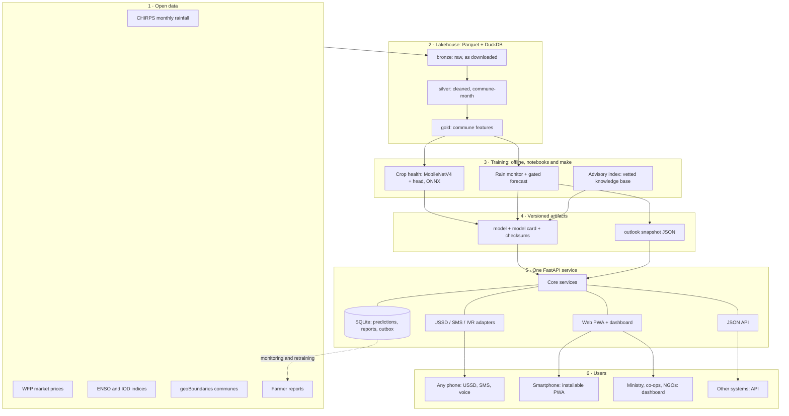

# Imbuto AI architecture

Status: MVP, built for the IndabaX Burundi talk on 6 November 2026.
The target system is in the [concept note](../Imbuto_AI_IndabaX_Burundi_2026.pdf).
This document describes what is built, and where it deliberately differs.

## The constraint that shapes everything

The note's principle is *meet the farmer where they are*. In numbers: internet use near 11%,
LTE under 16% of the territory, most subscribers on GSM, and about one person in ten with
electricity. So the design centre is a feature phone on 2G. The web app is one channel among
several, not the product.

Two consequences run through the design:

1. **Channels are thin.** USSD, SMS, IVR and web all call one channel-agnostic core. A new
   channel is an adapter, not a rewrite.
2. **Heavy work happens before the request arrives.** Rain summaries are computed in a batch and
   served from a snapshot, so a USSD session answers in milliseconds, inside the operator timeout.

## System view

## Components

| Part | What it does | Where |
| --- | --- | --- |
| Lakehouse | Downloads open data and builds bronze, silver and gold Parquet | `src/imbuto/lakehouse/` |
| Crop health | Photo to bean disease, with an "unsure" outcome | `src/imbuto/ml/crop_health.py` |
| Rain monitor | Measured season rain against each commune's history; forecast behind a gate | `src/imbuto/ml/risk.py` |
| Advisory | Retrieves approved passages, cites them, escalates when unsure | `src/imbuto/ml/advisory.py` |
| Bundles | Model, card, checksums; refuses to load if tampered with | `src/imbuto/ml/bundle.py` |
| Core | Channel-agnostic answers: outlook, prices, advice, diagnosis | `src/imbuto/core/` |
| Channels | USSD, SMS, IVR menu and renderers | `src/imbuto/channels/` |
| API and web | FastAPI, server-rendered HTML, service worker | `src/imbuto/api/` |
| Monitoring | Metrics, prediction log, drift, feedback | `src/imbuto/monitoring/` |

## How each channel reaches a farmer

| Channel | Phone needed | Data needed | Status in the MVP |
| --- | --- | --- | --- |
| USSD | Any GSM phone | None | Working menu; needs a short code and aggregator |
| SMS | Any GSM phone | None | Working commands and alert outbox; needs an aggregator |
| Voice (IVR) | Any phone | None | Keypad menu working; needs recorded Kirundi audio and a voice number |
| Web PWA | Smartphone | Light, then offline | Working; installable; photos queue offline |
| Dashboard | Any browser | Broadband is fine | Working |

Keypad IVR comes first because it needs **no speech recognition**. Recorded Kirundi prompts plus
digit presses serve a caller who cannot read, and they work before any ASR model exists.

## Low-bandwidth budget

These are enforced by tests in `tests/test_performance_budget.py`.

| Item | Budget | Why |
| --- | --- | --- |
| Farmer home page, gzipped, with CSS | under 14 KB | Fits the first TCP round trips, so 2G paints quickly |
| Photo upload | under 15 KB | The browser shrinks a 4 MB camera photo before sending |
| JavaScript | None required | Every form works with scripting off; JS only enhances |
| SMS reply | One 160-character GSM-7 segment | Each extra segment costs money |
| USSD screen | under 182 characters | Common GSM limit |

## Safety: where a wrong answer could hurt

Advice can cost a harvest, so the system is allowed to say *I don't know*.

- The advisory assistant answers **only** from `approved` documents, quotes them and cites them.
  Below the confidence threshold it hands over to a human instead of guessing.
- Crop diagnosis returns "unsure" below its threshold, and never names a pesticide.
- Farmers see measured rainfall with its source and date, not a forecast. The experimental
  forecast failed its promotion gate, so only the analyst dashboard shows it.
- **Everything written in Kirundi, and every knowledge-base document, is an unreviewed draft.**
  See [REVIEW_NEEDED.md](REVIEW_NEEDED.md). Drafts run only in demo mode, and the UI says so.

## Privacy

Consent-based, minimal collection, aligned with the 2026 data protection law (not yet checked by a
lawyer). Records are keyed by an HMAC of the phone number. The number itself is kept only for
people who agreed to alerts, and sending STOP deletes it. Photos are never stored. Dashboards show
aggregates, never individuals.

## Differences from the concept note

| Note proposes | MVP uses | Why | Decision |
| --- | --- | --- | --- |
| Airflow, Spark, dbt, Delta | Python, DuckDB, Parquet | Same bronze/silver/gold layers; runs on one laptop | [ADR 1](adr/0001-duckdb-lakehouse.md) |
| React | Server-rendered HTML + PWA | A framework alone would break the 2G budget | [ADR 2](adr/0002-html-first-web.md) |
| Native Android + TFLite | Installable PWA, server inference | Reaches Android and iPhone today; on-device model is next | [ADR 3](adr/0003-pwa-before-android.md) |
| Named gateway | Gateway-neutral adapters | Africa's Talking's FAQ does not list Burundi | [ADR 4](adr/0004-gateway-neutral-channels.md) |
| Forecast season risk | Measured rainfall; forecast gated | Backtests found no reliable skill | [ADR 5](adr/0005-rainfall-shortfall-target.md) |
| Separate model services | One service, batch outlooks | One person can run it; split when load requires | [ADR 6](adr/0006-modular-monolith.md) |

## Not built yet

A rainfall forecast that passes its gate, Kirundi ASR and TTS, Sentinel-2 NDVI, Lake Tanganyika flood warning, IGEBU data, crops beyond
beans, LLM-generated answers, on-device inference, native Android, and live operator integration.
The official 42-commune boundaries are also missing: no open geometry was found, so the map uses
the 119 pre-reform communes grouped into the five current provinces (approximate for the split
Rumonge and Muramvya areas).
